# Meadow — product scope and development sequence

<!-- CONTEXT: plan | LAYER: design -->
Status: selected design, not scheduled | Owner: Dave | Next: the Colony Run definition is the next design pass, after BS-4 (Dave, 30 Sep 2026; §6.2 "Next design pass"); the event director's selection logic still needs its own pass; the goal model's data, the job catalogue/dispatcher and the stable catalogues are `plans/archive/architecture-review_2026-09-24.md`'s C, G and B chains (Dave, 11 Sep 2026) | Dependency: current stabilisation and hands-on checks continue independently | Verified: 2026-09-30

This is Meadow's high-level product map. It defines what the game is trying to
prove, what is essential for the first feedback build, which foundations later
systems should share, and when to review or defer work. It is deliberately
above implementation slices: `NEXTSTEPS.md` remains the only execution queue,
and the detailed plans it names continue to own individual changes.

## 1. Product promise

Meadow's flagship experience is a multi-session colony-management game. The
player starts with a queen, builds a colony from the ground up, unlocks
capabilities, automates recurring work, notices where the colony is failing
and changes its organisation so the solution persists. The three primary
player fantasies, in order, are:

1. optimising jobs, stores and foraging;
2. surviving environmental pressures; and
3. solving a colony-management puzzle.

The desired rhythm is **observe → diagnose → reorganise → automate → face new
pressure**. Individual-bee control supports tutorials and emergencies; the
normal game increasingly operates through priorities, standing policy and
automation.

The first external audience is friends and family with mixed game experience
who tolerate rough edges. Their feedback is valuable only after the game is
clear enough that confusion with the interface can be distinguished from a
weak underlying decision.

## 2. Run types

- **Challenges** are focused, authored lessons and unusual problems. Completing
  them discovers skills for the main game. Challenges 1 and 2 deliberately
  remove the queen's normal Backup Roles grant.
- **Colony Run** is the working name for the flagship systemic game. It starts
  with a queen, includes contextual help from Dr Gallerin, builds through the
  skill tree and combines scheduled pressure with simulation-driven events.
  In the eventual main game, only skills discovered through Challenges are
  available for purchase.
- **Scenarios** are variants of the Colony Run with different starting states,
  environments, restrictions or objectives.
- **Sandbox** has no required win condition. It becomes available after the
  first set of Challenges and contains only features discovered through
  completed Challenges.
- **Early feedback run** is a temporary Colony Run policy, not a separate
  implementation. Every skill included in the alpha may become discoverable
  through progress in that run, so testers can exercise the game before the
  full Challenge campaign exists.

## 3. First feedback target

The first closed alpha is a saveable 90-minute arc that may be continued after
victory. Target timings are experience budgets, not promises that override a
player's pause or chosen speed. They assume ordinary play using the existing
time-scale/fast-forward control through low-attention stretches (waiting on
the foraging economy, winter's quiet weeks) — `GameConfig`'s day-length and
season defaults are not being retuned to hit these targets at 1x speed on
their own (decided 2026-09-03: `winter_countdown_days` + `winter_length_days`
alone is 35 in-game days, ≈117 real minutes at the default 200 seconds/day).
§13's gate reviews are where this gets checked against a real playthrough,
including whether the pacing controls are prominent enough that a tester
reaches for them without being told to.

| Time | Player outcome |
| --- | --- |
| About 5 minutes | The queen has established the colony and raised the first worker. |
| About 10 minutes | The player has achieved the first useful automation. |
| About 20 minutes | A serious, readable forage-and-weather crisis tests preparation and response. |
| About 60 minutes | The colony enters and survives its first winter. |
| About 90 minutes | After emerging from winter, the colony raises and releases gynes, reaches formal victory and may continue. |

The build does not need every planned feature. It needs one complete route
through the economy and skill tree to Gyne Rearing, representative pressures,
and enough continued play to prove that later branches have somewhere to go.

## 4. Scope status vocabulary

Use these labels in the product map so "planned" is never mistaken for
"built" and "built" is never mistaken for "player-ready":

- **Built foundation** — implemented and suitable to build on, though ordinary
  defect fixing and balancing may remain.
- **Built, review required** — implemented but still has a named hands-on,
  usability, balance or evidence question.
- **Designed, not scheduled** — product direction exists but has not entered
  `NEXTSTEPS.md`.
- **Needs design** — an idea worth retaining whose rules, ownership or player
  outcome are not yet settled.
- **Parked for later** — intentionally cannot delay the current milestone;
  reopening requires evidence or the named earlier milestone.
- **Cut from alpha** — retained in the wider product vision but absent and
  hidden in the first feedback build.

## 5. Current product inventory

### 5.1 Built foundation

- a playable queen-to-colony loop across meadow and hive views;
- bee roles and sub-modes for foraging, nursing, comb work, mining, honey,
  laying and idle behaviour;
- brood, royal jelly, comb construction, excavation, stores, energy, ageing,
  starvation, disease pressure, seasons, winter and gyne scoring;
- flowers with flowering windows and resource replenishment;
- rain/weather foundations, a rival hive and crab-spider predator foundations;
- Challenges, Scenarios, stage gating, Dr Gallerin guidance and tutorial
  checkpoints;
- save/load foundations, settings, accessibility options, fog of war,
  diagnostics and deterministic verification;
- a procedural visual fallback that lets development continue before bespoke
  art is complete.

### 5.2 Built, review required

The current queue and hands-on lists own the exact checks. At product level the
remaining work clusters are:

- Challenge 1 acceptance and Challenge 2 rescue/recovery evidence;
- UI hierarchy, control clarity, panel layout and command feedback;
- flower season/senescence readability and balance;
- comb construction/readability questions;
- settings surviving run changes;
- save/restore, predator and foraging behaviours that still have named live
  checks.

These are part of alpha stabilisation. They should continue through
`NEXTSTEPS.md`; this plan does not duplicate or reorder their slices.

### 5.3 Designed, not scheduled

- skill catalogue, resolver, campaign discovery and in-run purchasing;
- Colony Adaptations, deliberately after the skill tree;
- the long-form feedback run described here;
- the alpha workforce, Bee Bread, pollination and ecological rules below.

## 6. Essential versus later

### 6.1 Essential for the closed alpha

- the 90-minute queen → winter → gynes arc;
- contextual onboarding, clear controls and high-impact defect correction;
- long-, milestone-, short-term- and urgent-goal presentation;
- first-encounter explanations from Dr Gallerin and a persistent
  "Why is this happening?" route;
- resource production-versus-consumption, missing-workforce, waiting/travel and
  blocked-work diagnostics;
- progress-triggered skill discovery for the feedback-run policy;
- the retained alpha skill set and one selected route to Gyne Rearing;
- Backup Roles, early automation and Tier-3 Work Priorities progression;
- Bee Bread production, larval use and adult consequences;
- rain sensing/recall, predator avoidance and a readiness-aware crisis;
- named run saves, three rolling recovery checkpoints and reliable restore;
- Easy difficulty rules, a standard difficulty baseline and understandable
  failure/victory/continue states;
- balance and pacing evidence at the 5/10/20/60/90-minute gates;
- a simple feedback process for friends and family.

### 6.2 Shared foundations that precede content expansion

- **Run policy:** skill discovery, availability, difficulty, event pacing,
  victory, failure and continuation per run type.
- **Stable catalogues and resolver:** feature, skill, role, resource, goal and
  event IDs; typed effects; one availability/affordability authority.
- **Goal model:** separate long-term goals, milestones, optional short-term
  outcomes and urgent problems.
- **Event director:** hybrid selection using elapsed time, colony progress,
  readiness, recent events and difficulty. It schedules pressure; simulation
  rules determine the outcome.
- **Colony diagnostics:** reusable derived facts for UI, Dr explanations,
  automated checks and future balancing. First slice shipped 4 Sep 2026;
  contract now lives in `plans/reference/colony-diagnostics.md`.
- **Job catalogue and dispatcher:** jobs and sub-jobs are stable data used by
  roles, Work Priorities, individual overrides and later policies.
- **Persistence:** separate player profile and named run saves, migration,
  three rolling checkpoints, and restoration of progression/ecology state.
- **Authoring data:** Challenges, Scenarios and environments share validated
  data formats before a public editor is considered.
- **Observability:** deterministic balance scenarios and bounded diagnostics
  for every new economy or per-bee hot path.

**Overlap resolved 11 Sep 2026 (Dave).** `plans/archive/architecture-review_2026-09-24.md`
**is** the design pass for four of the foundations above: the stable catalogues
and resolver, the goal model, the job catalogue and dispatcher, and the
catalogue half of the event director. They are its B1, C2, C4, F2s, G1 and G2,
named as a behaviour-preserving refactor because that is how they are being
built, not because they are a smaller idea than this section describes. Do not
open a second design pass on any of the four; extend those slices instead.

**Run policy and the event director's selection logic are not covered there**
and remain this section's own open design work. They are product decisions --
what a run type does about discovery, difficulty, victory and continuation, and
how pressure is scheduled -- and the architecture review deliberately proposes
no gameplay change.

**Next design pass: the Colony Run definition (Dave, 30 Sep 2026).** Run
policy for the flagship run comes next, after BS-4 lands and ahead of
progression step 8. It is a high-reasoning pass whose output is a design
plan and its first slices (`plans/reference/colony-diagnostics.md` is the
model). Found missing by `docs/product-review-2026-09-30.md`: no run type
matches §2's Colony Run, and the pacing arc stands in for it with an
unplayed queen. It settles:

- the start state: a lone queen who backs up as a Nurse
  (`plans/now/brood-spine.md` decision 5), with or without starting comb;
- winter: onset is decided (a fixed day, `plans/now/winter-onset.md` WO-1);
  how many winters a run holds is not;
- victory, failure and continue (§7's long-term goal, §11's doomed state);
- skill discovery for the early feedback run (§2);
- **the four goal layers of §7.** The architecture review's C2 (Challenge
  goals as data) and C4 (the signal catalogue) built the parts; once that
  plan was archived nothing owned the Colony Run's layers. This pass does,
  which settles the 11 Sep note above against `NEXTSTEPS.md`'s claim that
  the goal model needed a pass of its own;
- **PE-2, the played pacing arc** (`plans/now/pacing-evidence.md`):
  `test_scenarios/alpha_arc_test.json` starts from the Colony Run's start
  and is played by a scripted reference player using only the `when` keys
  the harness honours (`scenario_actions.gd::_legacy_when_spec`); it stops
  after winter ends; repeats use different seeds (today's three replay one
  pinned seed); and the winter rows are judged against WO-1's schedule and
  a live colony, not 1x minutes, because §3's 3 Sep note assumes
  fast-forward through winter;
- **the run's identity** (Dave, 30 Sep 2026, from
  `docs/architecture-review-2026-09-30.md` F1 and F2). A run is
  `Session.starting_level`: compared as an integer 24 times (17 in
  `challenge_runner.gd`), resolved through `Levels.get_level()` 12 times,
  and absent from the save, so a load rebuilds whichever level is current
  (level 0 after a fresh boot) before replaying it. The pass decides where
  the Colony Run's type and policy live and how a save records them, and
  with them: level 0 and the six "World & start" starting settings, which
  shape only that throwaway world (if revived, `run_availability.gd` would
  not seed its nurse); the `win_conditions` and `unlocks` keys every
  `levels.gd` row carries and nothing reads; and whether milestones reuse
  the Challenge stage runner, which runs one stage at a time and starts only
  for levels 1 and 2 (the 18 Sep codebase review's CH-1 would come first),
  or a separate evaluator over `conditions.gd`, which has no rate key for
  "stable resource income".

### 6.3 Core expansion after feedback validates the base

- deeper standing policies, workforce targets and sub-role control;
- Colony Adaptations;
- broader weather and colony responses;
- ecosystem consequences and stewardship choices;
- additional diseases, pests, predators and environmental animals;
- Codex/Dr notes combining game guidance with bee biology;
- themed Challenge sets, additional Scenarios and environments;
- audio, broader sprite production and accessibility refinement.

### 6.4 Cut from alpha / protected experiments

- guards, combat, invading or robbing other colonies;
- nectar robbing and robber defence;
- drones, medicine, auto-defence/auto-attack;
- drought, Adjustment Panel, Chemical Cascade and Extended Backup Roles;
- public Scenario/environment editor, sharing, moderation and distribution;
- a 3D terrain conversion;
- detailed temperature and waste management;
- temporal polyethism as a simulation-wide rule;
- many individually modelled diseases/pests at once;
- multiple fully developed biomes, complete sprite replacement, full
  localisation and launch-scale audio;
- Steam commercial decisions that do not affect the alpha build.

"Cut from alpha" is not rejection. Reopening requires either the successful
closed-alpha gate or feedback showing the missing feature prevents the core
promise from working.

## 7. Goal and guidance model

1. **Long-term:** survive winter and release gynes.
2. **Milestones:** first worker, first automation, stable resource income,
   winter readiness, post-winter recovery and first gyne.
3. **Short-term:** optional, context-sensitive outcomes such as establish a
   pollen surplus or reduce blocked work. They state an outcome, not an exact
   click sequence, and carry no failure penalty.
4. **Urgent problems:** falling stores, starving brood, blocked work, dangerous
   weather or other immediate risks.

Dr Gallerin explains a problem on its first appearance, with occasional humour
and personality. Afterwards the player can request the same causal explanation
through "Why is this happening?". Advice should connect evidence to possible
responses without declaring one correct colony organisation.

## 8. Workforce progression

- **Start:** ordinary bees have one exclusive role.
- **Backup Roles — Hive Mind Tier 1:** one primary and one fallback role. The
  queen is granted this capability in ordinary runs; Challenges 1 and 2 remove
  the grant.
- **Automation — Hive Mind Tier 2:** automatic building and mining. Cleaning is
  also retained at Tier 2.
- **Work Priorities — Hive Mind Tier 3:** roles become priority presets which
  bees may depart from when colony needs demand it. Unlocks colony-wide
  job/sub-job ordering and individual-bee overrides.
- **Extended Backup Roles:** cut from alpha; Work Priorities provides the
  intended scalable control surface.

## 9. Bee Bread

Bee Bread is pollen plus honey deposited into a designated cell by a Honey
Worker in the **Fermenter** sub-role. The worker seals the cell; it ferments for
seven game-days, then becomes larval food and a Tier-3 progression currency.

Nurses feed available Bee Bread automatically. The later Priority Cells skill
allows deliberate allocation when supply is scarce.

Adult outcome is fixed at emergence and saved with the bee:

- raised without Bee Bread: 15-day lifespan, 95% speed and 95% carrying
  capacity;
- raised with Bee Bread: 25-day lifespan, 105% speed and 105% carrying
  capacity.

The exact pollen/honey recipe, cell capacity, larval ration and UI forecast are
balance decisions requiring the scenario harness; they are not guessed here.

## 10. Pollination and ecology

A bee earns one Pollinator Point when it moves from one flower individual to a
different individual of the same species, subject to one award per destination
plant's pollination window.

Track two ledgers:

- **Spendable Pollinator Points** are required by every Tier-4 skill. A recipe
  may add thematic resources; Gyne Rearing may also require royal jelly.
- **Pollination Contribution** is never spent. It drives ecological goals,
  seed outcomes and later environment improvements.

Compatible pollination increases seed set and offspring quality. A visit
arriving directly from another species contributes incompatible pollen,
reducing both. An unpollinated flower does not set seed. A separate minimum
background emergence/seed-bank probability prevents a species disappearing
from the simulation entirely.

Offspring quality gives a slight bonus or penalty to nectar and pollen amounts,
is bounded to ±15% of species baseline, and regresses toward that baseline
between generations so success cannot compound without limit.

The first sprite/readability set is **Dandelion, Poppy and Borage**, each with
rewarding, depleted, out-of-season and ageing/senescent treatment. Procedural
indicators handle overlapping states to avoid a combinatorial asset set.

## 11. Difficulty, failure and recovery

### Easy

- event timing follows player readiness more strongly than calendar day;
- ordinary workers may die from old age, but non-age damage and energy loss
  cannot kill them;
- a worker at one health or without energy moves at 25% speed until it returns
  to the hive, rests and clears minimum health and energy thresholds;
- predator attacks can injure and force retreat but cannot kill;
- the queen cannot die from any cause.

The queen cannot die of old age on any difficulty. Other difficulty rules need
a separate balance pass; they must remain visible preset rules rather than
hidden assistance.

The game creates a rolling checkpoint before each major crisis, before each
season transition and every five game-days, retaining the latest three. The
load menu lets the player voluntarily choose any retained checkpoint or named
manual save. A colony is doomed only when its queen has died and it has no
gynes; that state offers restore rather than silently ending the run.

## 12. Development and review sequence

Solid arrows show required sequence or dependency. Dotted arrows show
supporting, evidence, parallel or later-reopening relationships. Diamonds are
review or rule decisions rather than implementation tasks.

```mermaid
flowchart TD
    START["Current prototype<br/>Playable queen-to-colony loop"]

    subgraph STABILISE["0 · Stabilise and understand the existing core"]
        direction TB
        CURRENT["Finish or consciously supersede current narrow slices<br/>UI · Challenges · flowers · comb · settings"]
        HANDS["Run named hands-on checks<br/>foraging · predators · restore · interaction"]
        BASELINE["Record pacing, balance and performance baselines"]
        CORE_READY{"Clear enough to judge<br/>the underlying game?"}

        CURRENT --> HANDS --> BASELINE --> CORE_READY
        CORE_READY -->|No| CURRENT
    end

    START --> CURRENT

    subgraph FOUNDATIONS["1 · Shared alpha foundations — build before multiplying content"]
        direction TB
        RUN_POLICY["Run policy<br/>availability · discovery · difficulty · victory · continuation"]
        CATALOGUES["Stable catalogues and resolver<br/>skills · features · roles · resources · goals · events"]
        JOBS["Job and sub-job catalogue<br/>shared task dispatcher"]
        DIAGNOSTICS["Colony diagnostics<br/>production/consumption · shortages · waiting/travel · blocked work"]
        GOALS["Four-layer goal model<br/>long-term · milestones · short-term · urgent"]
        GUIDANCE["Dr Gallerin guidance<br/>first-encounter explanation + persistent Why?"]
        EVENTS["Hybrid event director<br/>time + progress + readiness + recent events + difficulty"]
        SAVE_MODEL["Persistence model<br/>player profile · named run saves · migrations"]
        CHECKPOINTS["Three rolling recovery checkpoints<br/>before crises/seasons + every five days"]
        AUTHORING["Validated authoring data<br/>Challenges · Colony Runs · Scenarios · environments"]
        OBSERVE["Observability<br/>scenario harness · bounded diagnostics · hot-path budgets"]
        EASY_RULES["Visible difficulty policy<br/>Easy readiness gates · non-age survival · queen protection"]

        RUN_POLICY --> CATALOGUES
        CATALOGUES --> JOBS
        CATALOGUES --> GOALS
        DIAGNOSTICS --> GOALS --> GUIDANCE
        DIAGNOSTICS --> EVENTS
        GOALS --> EVENTS
        RUN_POLICY --> EVENTS
        RUN_POLICY --> EASY_RULES
        RUN_POLICY --> SAVE_MODEL --> CHECKPOINTS
        CATALOGUES --> AUTHORING
        DIAGNOSTICS --> OBSERVE
        EVENTS --> OBSERVE
    end

    CORE_READY -->|Yes| RUN_POLICY
    CORE_READY -->|Yes| DIAGNOSTICS

    subgraph MODES["2 · One foundation, different run policies"]
        direction LR
        CHALLENGES["Challenges<br/>authored lessons discover skills"]
        MAIN_RUN["Main Colony Run<br/>only Challenge-discovered skills available"]
        FEEDBACK_RUN["Early feedback run<br/>all alpha skills discover through play"]
        SCENARIOS["Scenarios<br/>variant starts, environments and objectives"]
        SANDBOX["Sandbox<br/>after first Challenge set; discovered features only"]

        CHALLENGES -->|discover| MAIN_RUN
        CHALLENGES -->|unlock mode and features| SANDBOX
        MAIN_RUN --> SCENARIOS
    end

    RUN_POLICY --> CHALLENGES
    RUN_POLICY --> FEEDBACK_RUN

    subgraph PROGRESSION["3 · Alpha progression and economy critical path"]
        direction TB
        DISCOVERY["Progress-triggered discovery<br/>actions reveal skills; colony resources purchase them"]
        TIER1["Tier 1 foundation<br/>one role → Backup Roles · core brood/economy · rain sensing"]
        TIER2["Tier 2 capability<br/>automation · cleaning · Bee Bread · role expansion · rain recall"]
        TIER3["Tier 3 management<br/>Work Priorities · Pollinator Points · Royal Jelly · Priority Cells"]
        TIER4["Selected Tier 4 route<br/>Pollinator Points required · Royal Jelly also required for Gyne Rearing"]
        CONTINUE_SKILLS["Post-victory continuation<br/>remaining retained alpha skills and branches"]

        DISCOVERY --> TIER1 --> TIER2 --> TIER3 --> TIER4 --> CONTINUE_SKILLS
    end

    CATALOGUES --> DISCOVERY
    JOBS --> TIER1
    FEEDBACK_RUN --> DISCOVERY

    subgraph BEE_BREAD["3A · Bee Bread dependency"]
        direction LR
        BB_CELL["Designate Bee Bread cell"]
        BB_FILL["Fermenter sub-role<br/>adds pollen + honey"]
        BB_SEAL["Seal and ferment<br/>seven game-days"]
        BB_FEED["Nurses feed larvae automatically<br/>Priority Cells later allocates scarcity"]
        BB_ADULT["Adult outcome saved at emergence<br/>15d + 95% without · 25d + 105% with"]

        BB_CELL --> BB_FILL --> BB_SEAL --> BB_FEED --> BB_ADULT
    end

    TIER2 --> BB_CELL
    BB_SEAL --> TIER3
    JOBS --> BB_FILL
    SAVE_MODEL --> BB_SEAL
    SAVE_MODEL --> BB_ADULT

    subgraph POLLINATION["3B · Pollination and ecology dependency"]
        direction TB
        TRANSFER["Bee moves between different plants<br/>of the same species"]
        WINDOW{"Destination eligible<br/>in this pollination window?"}
        TWO_LEDGERS["Award spendable Pollinator Point<br/>and permanent Pollination Contribution"]
        COMPATIBLE["Compatible pollen<br/>raises seed set and offspring quality"]
        INCOMPATIBLE["Direct visit from another species<br/>reduces seed set and offspring quality"]
        SEED_SET{"Compatible pollination present?"}
        NO_SEED["No seed set<br/>separate background seed-bank emergence remains"]
        OFFSPRING["Offspring nectar/pollen quality<br/>bounded ±15% with regression to baseline"]

        TRANSFER --> WINDOW
        WINDOW -->|Yes| TWO_LEDGERS --> COMPATIBLE --> SEED_SET
        WINDOW -->|No point; pollen still affects plant| COMPATIBLE
        INCOMPATIBLE --> SEED_SET
        SEED_SET -->|No| NO_SEED
        SEED_SET -->|Yes| OFFSPRING
    end

    TIER3 --> TRANSFER
    TWO_LEDGERS --> TIER4
    OFFSPRING --> CONTINUE_SKILLS
    SAVE_MODEL --> TWO_LEDGERS
    SAVE_MODEL --> OFFSPRING

    subgraph PLAY_ARC["4 · Closed-alpha playable arc — experience budgets"]
        direction LR
        PLAY_START["0 min<br/>Queen alone"]
        PLAY_5["≈5 min<br/>First worker"]
        PLAY_10["≈10 min<br/>First useful automation"]
        PLAY_20["≈20 min<br/>Readable forage-and-weather crisis"]
        PLAY_MID["20–60 min<br/>Expand · Bee Bread · selected Tier 2–3 skills · prepare"]
        PLAY_60["≈60 min<br/>Enter and survive first winter"]
        PLAY_POST["Post-winter<br/>Recover · unlock selected Tier 4 route"]
        PLAY_90["≈90 min<br/>Raise and release gynes · victory · continue"]

        PLAY_START --> PLAY_5 --> PLAY_10 --> PLAY_20 --> PLAY_MID --> PLAY_60 --> PLAY_POST --> PLAY_90
    end

    AUTHORING --> PLAY_START
    TIER1 --> PLAY_5
    TIER2 --> PLAY_10
    EVENTS --> PLAY_20
    BB_ADULT --> PLAY_MID
    TIER3 --> PLAY_MID
    CHECKPOINTS --> PLAY_20
    CHECKPOINTS --> PLAY_60
    TIER4 --> PLAY_POST
    PLAY_POST -->|Gyne Rearing| PLAY_90
    GOALS -. guide .-> PLAY_START
    GUIDANCE -. explain .-> PLAY_20
    GUIDANCE -. explain .-> PLAY_60
    DIAGNOSTICS -. inform decisions .-> PLAY_MID
    EASY_RULES -. modifies failure and timing .-> PLAY_20

    subgraph REVIEWS["5 · Evidence gates — review the smallest responsible system"]
        direction LR
        GATE_5["5 min<br/>Can a mixed-experience player raise a worker?"]
        GATE_10["10 min<br/>Did automation remove repetition, not decisions?"]
        GATE_20["20 min<br/>Can the player diagnose and answer the crisis?"]
        GATE_60["60 min<br/>Can they read the economy, save/resume and survive winter?"]
        GATE_90["90 min<br/>Can they explain the result, and want to continue?"]
        CLOSED_ALPHA["Friends/family closed alpha<br/>mixed game experience · no live instruction"]
        CORE_PROMISE{"Different viable organisations?<br/>Clear decisions? Desire to replay?"}

        GATE_5 --> GATE_10 --> GATE_20 --> GATE_60 --> GATE_90 --> CLOSED_ALPHA --> CORE_PROMISE
    end

    PLAY_5 -. evidence .-> GATE_5
    PLAY_10 -. evidence .-> GATE_10
    PLAY_20 -. evidence .-> GATE_20
    PLAY_60 -. evidence .-> GATE_60
    PLAY_90 -. evidence .-> GATE_90
    CORE_PROMISE -->|No| FIX_SMALLEST["Return to the smallest responsible system<br/>clarity · pacing · balance · defect · decision quality"]
    FIX_SMALLEST --> CURRENT

    subgraph EXPANSION["6 · Expand only after the core is validated"]
        direction TB
        SELECT_ONE["Select one evidence-backed expansion pillar"]
        POLICY_EXPAND["Deeper policy and workforce control"]
        ADAPTATIONS["Colony Adaptations"]
        ECOLOGY_EXPAND["Ecosystem stewardship and environments"]
        THREATS_EXPAND["Weather, diseases, pests and predators"]
        CONTENT_EXPAND["Challenge sets, Scenarios, Codex and Dr notes"]
        PRESENTATION_EXPAND["Audio, sprites, accessibility and presentation"]
        BETA_GATE{"Core systems feature-complete?<br/>No new foundation required?"}

        SELECT_ONE --> POLICY_EXPAND --> BETA_GATE
        SELECT_ONE --> ADAPTATIONS --> BETA_GATE
        SELECT_ONE --> ECOLOGY_EXPAND --> BETA_GATE
        SELECT_ONE --> THREATS_EXPAND --> BETA_GATE
        SELECT_ONE --> CONTENT_EXPAND --> BETA_GATE
        SELECT_ONE --> PRESENTATION_EXPAND --> BETA_GATE
        BETA_GATE -->|No| SELECT_ONE
    end

    CORE_PROMISE -->|Yes| SELECT_ONE

    subgraph CREATIVE["Parallel creative stream — motivating, useful, never blocks playability"]
        direction LR
        ART_QUEUE["Keep 3–6 television-friendly tasks ready"]
        FLOWER_SPRITES["Dandelion · Poppy · Borage<br/>rewarding · depleted · out-of-season · ageing"]
        ENV_ART["Common environmental components"]
        BEE_HIVE_ART["Bee activities and hive components"]
        WEATHER_ANIMALS["Weather, animals and threats"]

        ART_QUEUE --> FLOWER_SPRITES --> ENV_ART --> BEE_HIVE_ART --> WEATHER_ANIMALS
    end

    FLOWER_SPRITES -. supports readability .-> PLAY_20
    ENV_ART -. supports atmosphere .-> CLOSED_ALPHA

    subgraph RELEASE["Parallel production and release stream"]
        direction LR
        INTERNAL_ALPHA["Internal alpha<br/>90-minute route works with placeholders"]
        DISTRIBUTION["Installable build · crash/feedback route · accessibility/performance review"]
        BETA["Beta<br/>content and core systems feature-complete"]
        EARLY_ACCESS["Early Access<br/>durable saves · replayability · honest roadmap · community process"]
        ONE_ZERO["1.0<br/>promised modes/content complete · polished · supported"]

        INTERNAL_ALPHA --> DISTRIBUTION --> BETA --> EARLY_ACCESS --> ONE_ZERO
    end

    PLAY_90 --> INTERNAL_ALPHA
    CLOSED_ALPHA --> DISTRIBUTION
    BETA_GATE -->|Yes| BETA

    subgraph PARKED["Protected ideas — retained, but cannot delay closed alpha"]
        direction LR
        COMBAT_LATER["Guards · combat · invading/robbing · auto-defence"]
        BIOLOGY_LATER["Drones · medicine · temperature · waste · temporal polyethism"]
        WORLD_LATER["Drought · multiple biomes · 3D terrain"]
        CREATOR_LATER["Public Scenario/environment editor<br/>sharing · moderation · distribution"]
        LAUNCH_LATER["Full localisation · launch-scale audio/art<br/>price · studio identity · charity model"]
    end

    CORE_PROMISE -. may reopen with evidence .-> COMBAT_LATER
```

### Sequence rules

1. Finish or consciously supersede the current stabilisation evidence before
   building a large system on top of it.
2. Reconcile `plans/design/progression.md` before implementing progression:
   Work Priorities moves from baseline to Hive Mind Tier 3; Weather Sensing
   becomes rain-only in alpha; Bee Bread and Pollinator Points use the rules
   above; Pollinator Points replace royal jelly as the universal Tier-4 gate.
3. Build catalogue/resolver/run-policy plumbing before skill content, following
   the existing progression plan's safe extension pattern.
4. Prove each new system through the shortest playable vertical path. Do not
   implement every branch before testing the first ten or twenty minutes.
5. Gyne Rearing remains Tier 4. The alpha deliberately reaches that selected
   route after winter; it does not complete every Tier-3 branch first.
6. Treat Bee Bread, Work Priorities, pollination ecology and save/checkpoint
   changes as separate high-risk systems with their own validation, not one
   bundled feature.
7. Admit implementation through `NEXTSTEPS.md` one slice at a time. This plan
   defines order and gates but is never a second queue.

## 13. Review gates

| Gate | Question that must be answered | Evidence |
| --- | --- | --- |
| Current-loop review | Are existing controls and feedback reliable enough to judge the game? | Current queue, deterministic checks and named hands-on checks. |
| 5 minutes | Can a mixed-experience player raise the first worker without step-by-step scripting? | Observation plus a short comprehension question. |
| 10 minutes | Has automation removed repetition without removing the player's decisions? | Player explanation of what they automated and why. |
| 20 minutes | Can the player diagnose and respond to the first crisis? | Actions taken, Why? usage and post-crisis explanation. |
| 60 minutes | Can the player understand production/consumption, save/resume and prepare for winter? | Economy trace, restore test and player account. |
| 90 minutes | Can the player explain victory or failure and do they want to continue? | Gyne result, short interview and observed friction. |
| Closed alpha | Do multiple players reach the same understanding through different viable organisations? | Cross-player feedback grouped by clarity, decisions, pacing, defects and desire to replay. |

Failure at a gate sends work back to the smallest system responsible. It does
not justify adding unrelated content.

## 14. Parallel non-coding and production streams

### Relaxing creative stream

Keep three to six television-friendly sprite tasks available at all times.
Start with Dandelion, Poppy and Borage state sets, then common environmental
components, bee activities, hive components, weather and finally animals or
threats. Allow occasional motivational art outside strict production order;
the procedural fallback means it must not block playability.

### Evidence and feedback stream

- internal milestone play at 5/10/20/60/90 minutes;
- friends/family observation before broad distribution;
- feedback separated into defect, confusion, pacing, decision quality and
  desired expansion;
- balance changes backed by repeatable scenario evidence where possible.

### Release stream

Before the first feedback build: the nine §6.4 cut skills (Guard bee,
Combat, Auto-defence, Nectar robbing, Drones, Medicine, Adjustment panel,
Extended backup roles, Chemical cascade) are unavailable and hidden, and
every other tree node either does what it says or is marked not built. On
30 Sep 2026 only four of the 34 non-baseline nodes changed anything when
bought: Tarsal secretions, Orientation flight, Nurses and Honey worker
(`docs/product-review-2026-09-30.md`).

Before Early Access: named saves and migrations, stable distributable builds,
crash/feedback collection, accessibility review, performance budgets, asset
licence register, store page/capsules/trailer, pricing, community expectations
and a public roadmap whose promises match proven capacity.

Before 1.0: content-complete core, onboarding and difficulty coverage, broader
audio/art, localisation decision, platform/input decision, legal/ratings/tax
checks, Steam achievements/cloud/workshop decisions, and a final save-support
policy. Charity proceeds and whether to present as a studio are commercial and
legal decisions for the release stream, not alpha blockers.

## 15. Release stages

- **Current prototype:** playable core, narrow stabilisation and evidence work.
- **Internal alpha:** the full 90-minute route works with placeholder art and
  developer-supported setup.
- **Closed alpha:** friends/family can install, save, resume and provide useful
  feedback without live instruction.
- **Beta:** core systems are feature-complete; work shifts toward content,
  balance, usability, accessibility, performance and presentation rather than
  new foundations.
- **Early Access:** replayable product with transparent scope, durable saves,
  a feedback/community process and enough content to justify payment.
- **1.0:** the promised modes and content are complete, polished and supported.

## 16. Open design questions that do not block this scope

- exact Work Priorities dispatch rules and its scalable many-bee UI;
- Bee Bread recipe quantities, rationing and fermentation feedback;
- exact skill discovery milestones and costs in the 90-minute route;
- Pollinator Point window duration and seed/quality formula;
- Standard and harder difficulty rules;
- short-term-goal selection, concurrency and dismissal behaviour;
- named-save count, naming, overwrite and deletion UX;
- detailed post-alpha threat, ecosystem and environment order;
- Early Access content volume, price, demo, studio identity and charity model.

Resolve these in focused design/evidence passes when the development sequence
reaches them. They are not reasons to reopen the whole scope.

